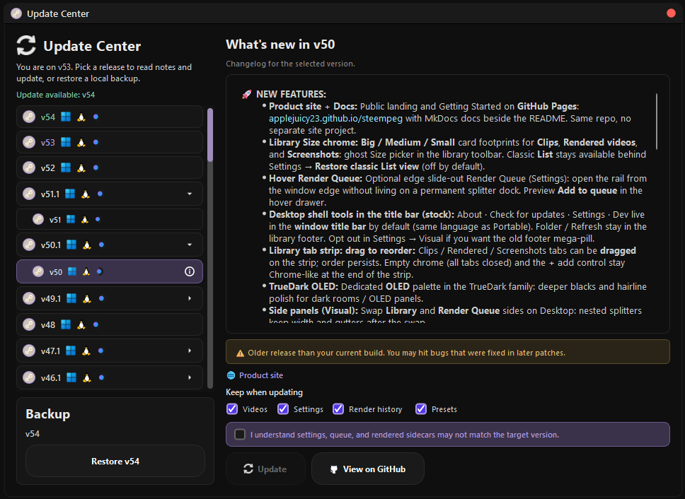
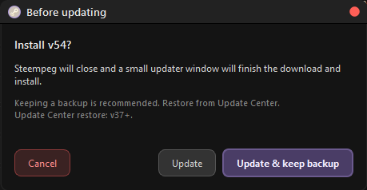
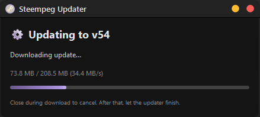
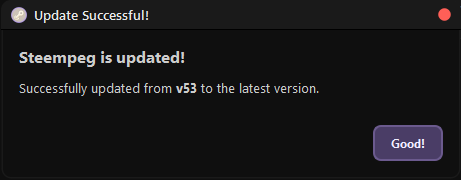

# Updates and backups

Steempeg updates itself from
[GitHub Releases](https://github.com/applejuicy23/steempeg/releases). It never
installs anything without you clicking **Update**.

---

## Checking

**Settings → General → Updates → Check for updates**:

| Option | When it checks |
|---|---|
| **Off** | Never on its own |
| **Every launch** | Once each time Steempeg starts |
| **Daily** / **Weekly** | At launch, once the cooldown has passed |

When a newer version exists, an **Update Available** badge appears in the
title bar. Hide it with **Never show Update Available badge**; checking by
hand and the Update Center still work.

To check right away, use the **Check for updates** button in the title bar.

---

## Update Center

Opens from the badge or the button. It lists every public release.

- Pick a version on the left. The icons show which platforms it was built
  for. Patch releases fold under their version; the arrow expands them.
- **What's new** shows the changelog of the selected version.
- **Update** installs it. Any version works, including **older** ones, so you
  can downgrade the same way.
- **View on GitHub** opens the release page.

Picking an older version shows a warning (*"Older release than your current
build…"*) and an extra box: *"I understand settings, queue, and rendered
sidecars may not match the target version."* Tick it to enable **Update**.

### Your platform only

The Update Center picks the download that matches the build you are running:

| Build | Downloads |
|---|---|
| Windows | `Steempeg_vXX.zip` |
| Linux | `Steempeg_vXX_linux.zip` |
| Steam Deck | `Steempeg_vXX_steamdeck.zip` |

---

## What happens when you update

1. Steempeg asks how to update:
    - **Update & keep backup** *(recommended)*: the current version is moved
      into an `old_version_vXX` folder next to the program before the new one
      is unpacked;
    - **Update**: no backup.

    { width="460" }

2. Steempeg closes and the **Steempeg Updater** window downloads and installs
   the release. Closing it during the download cancels the update; once the
   download is done, let it finish.

    { width="440" }

3. The new version starts by itself and says **Steempeg is updated!**

    { width="460" }

### What always survives

These folders next to the program are never touched by an update or a
restore:

| Folder | Holds |
|---|---|
| `cache` | Settings, presets, render queue and history, health and library caches, your markers |
| `rendered_videos` | Default export folder |
| `Screenshots` | Player screenshots |
| `logs` | Session logs |

Older `old_version_vXX` backups stay too, side by side.

---

## Going back

### Restore a backup

**Update Center → Backup** shows your local backups (pick one if there are
several). **Restore vXX** puts that version back. Restore works for backups
made by v37 and newer.

### Import from backup

**Settings → Support → Import from backup…** copies your data (rendered
videos, screenshots and `cache`) **from** a backup into the current version.
Files that already exist are skipped, nothing is overwritten. Useful after
updating without the right data, or to pull renders out of an old install.

Right after an update with a backup, the **Steempeg is updated!** window has
**Import from previous build** and **📂 Open Backup Folder**. That import
follows **Keep when updating** in the Update Center:
**Videos** brings `rendered_videos` and `Screenshots`; **Settings**, **Render
history** or **Presets** bring `cache`.

---

## Installed vs portable (Windows)

Both update the same way. The installer puts Steempeg in
`%LocalAppData%\Programs\Steempeg`, which needs no admin rights, so the
updater can write there just like into a portable folder.
