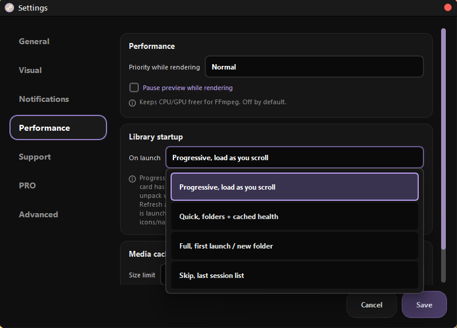
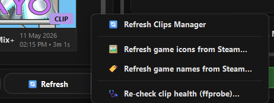

# Launch modes

How Steempeg loads the Clips Manager when it starts. Pick the mode in
**Settings → Performance → Library startup → On launch**.

{ width="560" }

| Mode | In the menu | What happens on launch | Good for |
|---|---|---|---|
| **Progressive** *(default)* | Progressive, load as you scroll | Placeholders first, cards fill in as you scroll | Everyday launches, big libraries |
| **Quick** | Quick, folders + cached health | Rescans the clip folders, reuses saved health results | You add clips often and want them listed right away |
| **Full** | Full, first launch / new folder | Rescans folders, re-checks every clip with ffprobe, refreshes game icons and names from Steam | After moving or repairing many clips |
| **Skip** | Skip, last session list | Paints the list saved at the end of the last session | Libraries that rarely change |

---

## Progressive

The Clips grid shows a placeholder for every clip almost instantly. Real
ClipCards are built only for what is on screen, plus a quiet fill in the
background while you are idle.

- A card that has loaded **stays loaded**, so scrolling back is smooth.
  Scrolling into a new stretch of the library can hitch for a moment while
  those cards are built.
- Clip durations and posters fill in after the list is up.
- **Refresh** and **adding a clips folder** always run a Full scan, even while
  Progressive is selected. Progressive only applies to the launch itself.

## Quick

Rescans every clip folder, so new and deleted clips show up correctly, but
reuses the health results saved from earlier checks instead of running
ffprobe again. Cards are still built only for the screen you are looking at.

## Full

The most thorough mode, and the slowest.

1. Rescans every clip folder.
2. Runs the full health check on every clip, including the ffprobe open test
   (see [Clip health](clip-health.md)).
3. Once the list is painted, refreshes **game icons**, then **game names**,
   from Steam.

!!! note "First launch is always Full"
    When Steempeg finds your Steam recording folders by itself on the very
    first launch, it runs Full **once**, whatever mode is selected. Later
    launches go back to your chosen mode.

## Skip

Steempeg saves the Clips list at the end of each session
(`cache/clips_library_cache.json`). Skip paints that saved list, then quietly
adds clips that appeared since.

Rendered Videos and Screenshots come back from their own saved lists too.

!!! warning
    With a large library Skip often feels as slow as a real scan, because
    every saved card still has to be painted. Progressive is usually faster.

---

## Doing a full pass by hand

You do not need to switch modes to refresh. The **Refresh ▾** menu under the
Clips grid has:

{ width="460" }

| Item | What it does |
|---|---|
| **🔄 Refresh Clips Manager** | Full rescan of all clip folders |
| **🖼️ Refresh game icons from Steam…** | Re-downloads game icons |
| **🏷️ Refresh game names from Steam…** | Re-fetches game names |
| **🩺 Re-check clip health (ffprobe)…** | Full health check on every clip, with the ffprobe open test |
