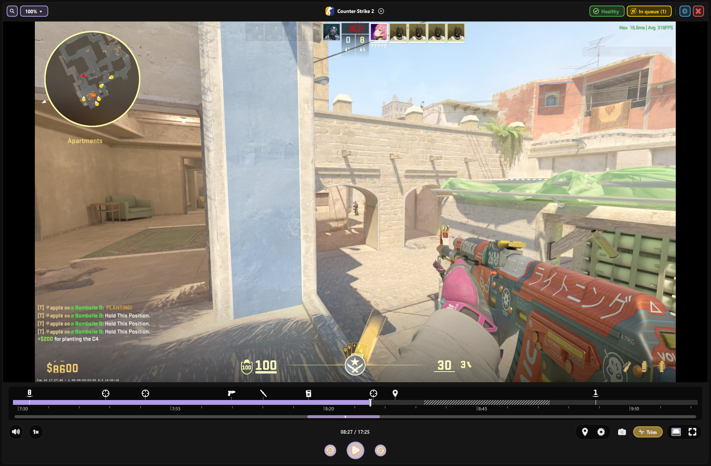
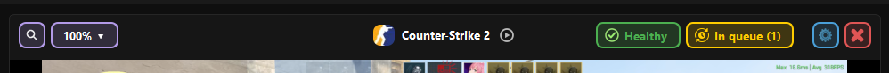
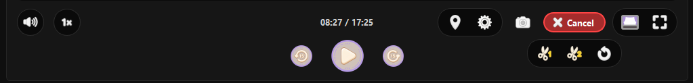
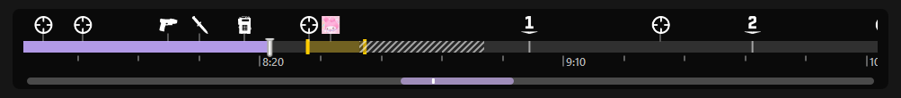
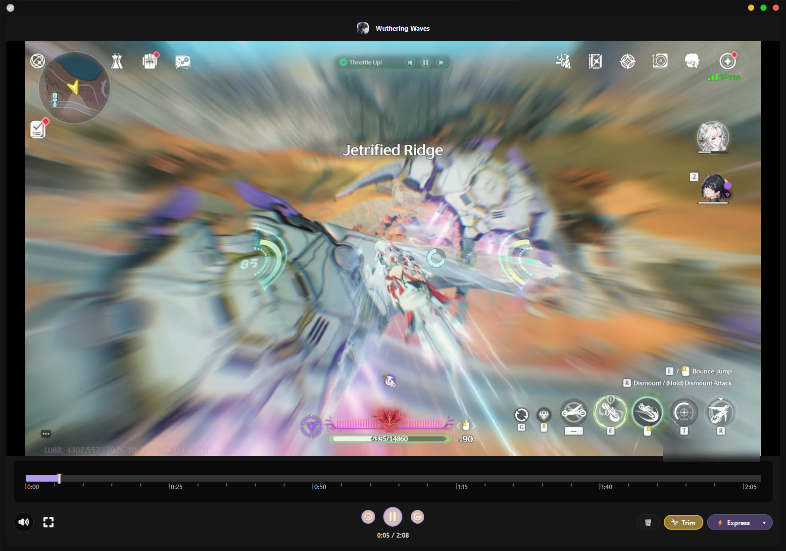

# Player

The player sits in the middle of the window. It plays Steam clips straight
from their DASH chunks, so nothing is converted before you watch.

!!! tip "Preview never changes your export"
    Everything on this page (preview quality, speed, volume, theatre, zoom)
    only affects what you **see**. Renders always use the original clip at
    the settings in the render panel.

---

## Header

The strip above the video.

| Element | What it does |
|---|---|
| **🔍 Loupe** | Click to arm: the mouse wheel zooms toward the cursor, dragging pans. Click again to turn it off. |
| **Preview zoom** *(the `100%` chip)* | Zoom steps: **100%**, **125%**, **150%**, **200%**, **300%**. |
| **Game icon + name** | The open clip. Hover **(i)** for date, time and duration. |
| **Health button** | `Healthy` / `Issues` / `Dead` / `Cured`; click for details. See [Clip health](../library/clip-health.md). |
| **In queue (N)** *(yellow chip)* | The clip's place in the Render Queue. If it is queued more than once, the number cycles. |
| **Preview quality** *(blue chip)* | Downscales the preview: **Source**, **1080p**, **720p**, **480p**, **360p**. |
| **Close clip** *(red chip)* | Closes the clip and frees the player. |

**Preview quality** switches live: the file is not reloaded and the playhead
stays where it is. If the clip is already smaller than the chosen height,
nothing changes. Use a lower step on a weak GPU or when rendering in the
background.

---

## Footer controls

| Control | What it does |
|---|---|
| **▶ Play / Pause** | Also: **Space**, or a click on the picture. |
| **Skip back / forward** | Jumps 15 seconds. |
| **Volume** | Slider; 100% is the clip's own level. |
| **Speed** *(the `1x` button)* | Playback speed, up to 5.0x by default. Pitch is corrected. |
| **📍 Add User Marker** | Drops your own marker at the playhead. |
| **Marker settings** | Which Steam markers show and how they look. |
| **📸 Take Screenshot** | Saves the current frame as PNG. |
| **✂ Trim** | Trim mode: drag the yellow handles to set in and out. While it is on, the button turns into a red **Cancel** and three tools appear under it: **Set Start (Cut Left)**, **Set End (Cut Right)** at the playhead, and **Jump to Start**. |
| **Theater Mode** | Hides the side and bottom panels so the video fills the window. |
| **Fullscreen** | Hides all chrome. **Esc** leaves. |

### Louder or faster than the stock caps

**Settings → Visual → Player controls**:

- **Volume ceiling**: `100%` (default) up to `500%`. Above 100% the sound is
  soft-amplified.
- **Speed ceiling**: `5.0x` (default), `8.0x` or `10.0x`.

---

## Timeline

| Action | Result |
|---|---|
| Click / drag on the track | Seek |
| **Mouse wheel** | Scrolls the strip left and right |
| **Ctrl + wheel** or **Alt + wheel** | Zooms the timeline in and out |
| Right-click the track | **📍 Add Marker Here** · **📸 Take Screenshot Here** |
| Right-click a marker | Edit / Duplicate / Delete (your own markers), **➡️ Go to Marker Settings**, **✂️ Set Trim Start Here**, **📸 Take Screenshot Here** |

Steam's own timeline markers (including screenshots you took in game) show on
the strip.
Turn them off with **Settings → Visual → Markers → Markers on the strip**.
Screenshot markers also offer **🖼 Open Screenshot** and
**📂 Open Screenshot folder**.

---

## Theatre and fullscreen

- **Theatre** keeps the window but collapses the Clips Manager and the render
  panel. Click the button again to bring them back exactly as they were.
- **Fullscreen** goes immersive inside the Steempeg window: header, footer and
  side panels hide, only the video stays. **Esc** or the button exits.
  Pressing fullscreen while in theatre leaves theatre first.

**Settings → Advanced → Fullscreen → Skip grey flash on fullscreen
enter/exit** (on by default) removes the grey cover during the switch. It can
leave a short black edge on exit; turn it off if that bothers you.

---

## Look and layout

All in **Settings → Visual**, with a live preview while the combo is open.
**Save** keeps the change; **Cancel** restores the last saved one.

| Setting | Options |
|---|---|
| **Player header → Layout** | **Steam-like** (default): centered logo and name. **SteempegUI**: left-aligned title with date, time and duration. |
| **Player header → Size** | Small / Medium / **Large** (default) |
| **Player layout → Layout** | **Reunited**: header, video and footer as one block. **Fractured**: gaps between them. |
| **Player layout → Outline** | With lines / Without lines / With lines, not wrapping the video |
| **Player timeline → Strip size** | Small / Medium / **Large** (default): size of the time labels and ticks |

---

## Performance

| Setting | Where | Effect |
|---|---|---|
| **Pause preview while rendering** | Performance | Frees CPU/GPU for FFmpeg. Off by default. |
| **Hardware decode** | Advanced → Preview decode | GPU decoding for the preview. Applies after a restart. |

---

## Express player

The small player that opens from the **new clip** popup (Steempeg running in
the tray) has its own keys:

| Key | Action |
|---|---|
| **Space** | Play / Pause |
| **← / →** | Skip back / forward |
| **F** | Fullscreen |
| **Esc** | Leave fullscreen |
