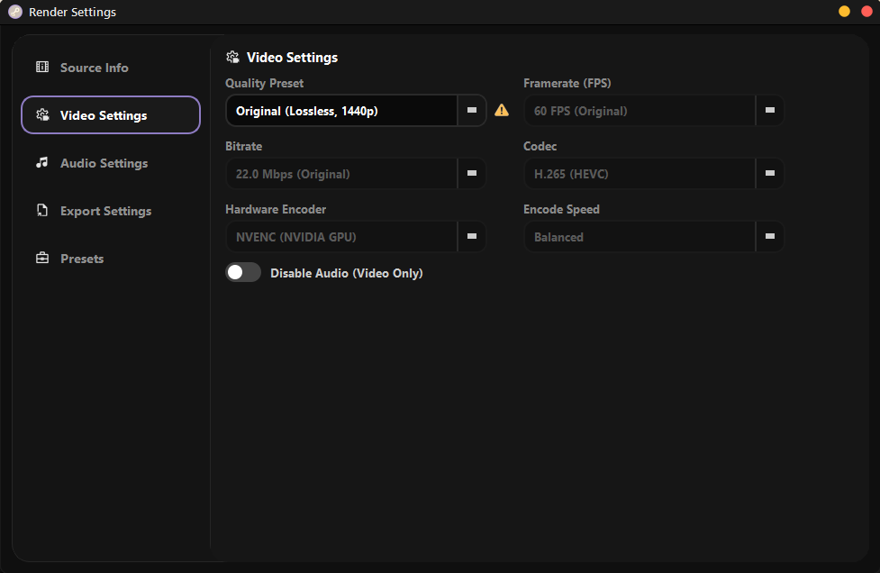
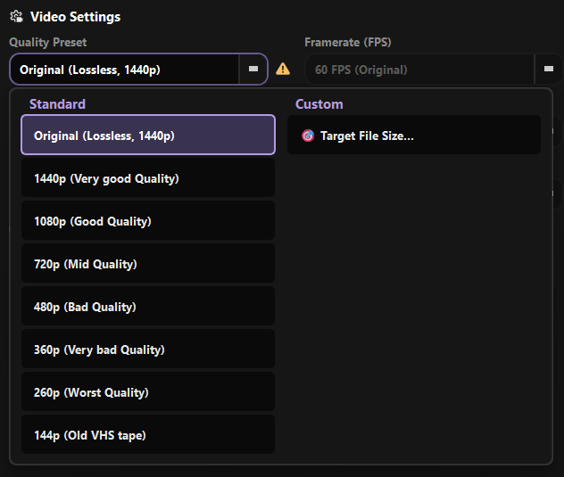
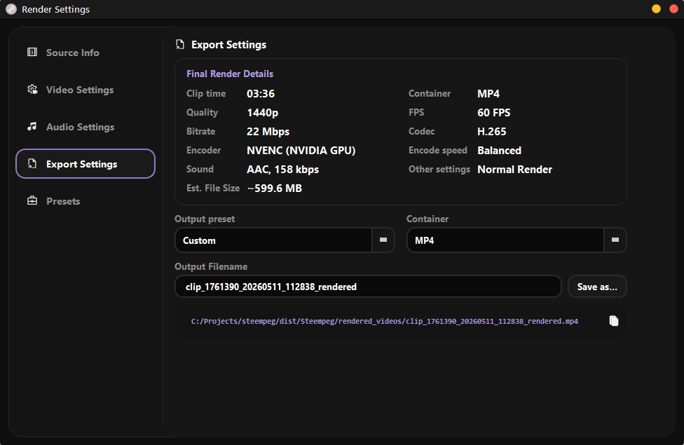
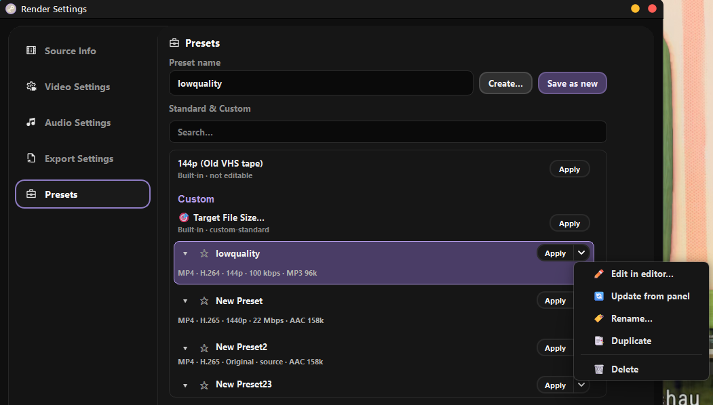

# Render settings

Render settings decide how the clip is exported. They have five tabs:
**ℹ️ Source Info**, **🎞 Video Settings**, **🎵 Audio Settings**,
**💾 Export Settings** and **Presets**.

Where they live depends on **Settings → General → Render panel → Desktop
layout**:

- **Like a Portable** *(stock)*: the purple **Render Settings** button next
  to **START RENDER** opens them in a separate window. Click it again
  (**Close Settings**) to close the window. **START RENDER**, **Pause**,
  **Cancel** and **Logs** stay in the main window.
- **It's a Desktop**: the classic render panel docked in the main window,
  with the buttons under the tabs.

Pick the tab that opens first in **Settings → General → Render panel →
Default tab** (stock: Video Settings).

---

## What the panel is editing

- **Basic**: the clip selected in the Clips Manager. **START RENDER** exports
  that clip with the panel settings and your trim.
- **Queue**: when a Render Queue job is selected, the panel edits **that
  job's** settings. Each job keeps its own settings, trim and output path,
  and the queue runs top to bottom.

---

## ℹ️ Source Info

Read-only facts about the open clip: **Original resolution**, **Time**,
**FPS**, **Size**, video bitrate.

---

## 🎞 Video Settings

| Control | Options |
|---|---|
| **Quality Preset** | **Original (Lossless)**, a resolution ladder, your custom presets, **🎯 Target File Size...** |
| **Framerate (FPS)** | The clip's own FPS (Original) or a lower one |
| **Bitrate** | Bitrate tier for the chosen height |
| **Codec** | H.265 (HEVC), H.264 (AVC), AV1, VP9 |
| **Hardware Encoder** | Whatever your machine supports, for example **NVENC (NVIDIA GPU)** or **CPU (Software)** |
| **Encode Speed** | Ultra Fast · Fast · **Balanced** (default) · Quality · Max Quality |
| **🔇 Disable Audio (Video Only)** | Exports a silent video |

### Original vs re-encode

**Original** does not re-encode. Steempeg joins the clip's chunks into one
file (remux), so it is very fast and loses nothing. Every other quality
preset **re-encodes** the video with the codec and encoder you picked.

### The resolution ladder

{ width="520" }

The list shows only the steps that fit your clip, so a 1440p clip starts at
1440p.

| Height | Name |
|---|---|
| 4320p and taller | Goddess Quality |
| 2160p | Divine Quality |
| 1440p | Very good Quality |
| 1080p | Good Quality |
| 720p | Mid Quality |
| 480p | Bad Quality |
| 360p | Very bad Quality |
| 260p | Worst Quality |
| 144p | Old VHS tape |

**🎯 Target File Size...** lets you set the size of the output file;
Steempeg works out the bitrate to hit it.

### Encode Speed

Trades speed for compression. Each step maps to the encoder's own presets:

| Encode Speed | NVENC | x264 / x265 | SVT-AV1 |
|---|---|---|---|
| Ultra Fast | p1 | ultrafast | 12 |
| Fast | p3 | veryfast | 10 |
| Balanced | p4 | medium | 6 |
| Quality | p6 | slow | 4 |
| Max Quality | p7 | veryslow | 2 |

### Advanced Encoding (Steempeg PRO)

With PRO on, an extra block appears:

| Control | What it sets |
|---|---|
| **Rate Control** | **Bitrate** (fixed rate) or **Constant Quality** |
| **Constant Quality** | Quality level when Rate Control is Constant Quality |
| **Encoder Preset** | The encoder's raw preset, overriding Encode Speed |
| **Tune** | Content tuning (film / animation / grain…), depending on the encoder |
| **Keyframe Interval** | Distance between keyframes |

---

## 🎵 Audio Settings

| Control | Options |
|---|---|
| **Format** | AAC, MP3, Opus, FLAC, WAV, **Copy** (keeps the original audio untouched) |
| **Bitrate** | For lossy formats (AAC, MP3, Opus) |
| **🎞️ Disable Video (Extract Audio Only)** | Exports only the sound |

---

## 💾 Export Settings

| Control | What it does |
|---|---|
| **Final Render Details** | Summary of everything that will be used, with the estimated file size |
| **Output preset** | **Custom**, or a ready combo (see below) |
| **Container** | MP4, MKV, MOV, WebM |
| **Output Filename** | File name without extension; the right one is added for you |
| **Save as…** | Where the file lands. The full path shows underneath, with a copy button |

| Output preset | Container | Video | Audio |
|---|---|---|---|
| **Share** | MP4 | H.264 (AVC) | AAC |
| **Edit** | MKV | H.265 (HEVC) | FLAC |
| **Web** | WebM | VP9 | Opus |

Combos that cannot work together (for example a codec the container does not
support) are disabled in the lists.

The default export folder is set in **Settings → General → Export**.

---

## Presets

Saves a full set of render settings under a name.

- **Standard & Custom** lists the built-in presets and yours, with **Search…**.
- **Apply** loads the preset into the panel. Built-in presets have only this
  button; they can't be edited.
- Your own presets have **★** to pin them, a recipe you can expand to see
  every setting, and **Apply ▾**. Its arrow opens **✏️ Edit in editor…**,
  **🔄 Update from panel** (overwrite the preset with the current panel),
  **🏷️ Rename…**, **📑 Duplicate** and **🗑️ Delete**.
- To make a new one, type a **Preset name** and press **Save as new**
  (current panel settings), or **Create…** to build it in the editor.

---

## While rendering

| Setting | Where | Effect |
|---|---|---|
| **Priority while rendering** | Performance | Process priority for FFmpeg |
| **Pause preview while rendering** | Performance | Stops the player so FFmpeg gets the CPU/GPU |
| **Notify when render finishes or fails** | Notifications | Toast and sound when Steempeg is minimized |
